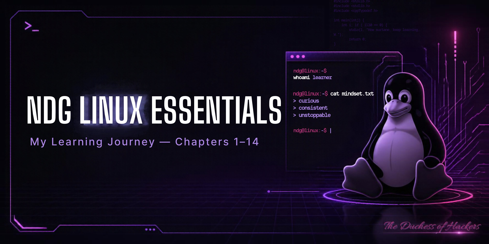

#  My NDG Linux Essentials Learning Journey

Welcome to my Linux learning journey! 💜

I'm learning Linux through **Akwannya Hub's Skill Pods**, as part of my journey into cybersecurity and technology.

This repository documents my progress through the 14 chapters of NDG Linux Essentials, including key concepts, useful commands, practical exercises, and lessons I've learnt along the way.

I'm still learning, and this repository is a way to track my progress, practise what I learn, and build a reference I can return to whenever I need it.

##  What I'm Learning

### Chapter 1–3: Linux Fundamentals

These chapters introduced me to Linux and helped me build an understanding of its environment.

Some of the key concepts I explored include:

- Linux, its kernel, and Linux distributions.
- The terminal and basic command-line navigation.
- Package managers and software dependencies.
- Linux security, access, and virtualisation.

Commands I started practising include:

```
pwd
ls
cd
mkdir
touch
cat
```

### Chapter 4: Open Source Software and Licensing

I learnt the difference between open-source and proprietary software, why software licences matter, and how organisations such as the Free Software Foundation and Open Source Initiative promote software freedom.

### Chapter 5: Command-Line Skills

I explored how to interact with Linux through the terminal, understand command syntax, use command history, and work with variables and shell features.

Useful commands and concepts:

```
history
echo $PATH
which
type
alias
```

I also learnt how to combine commands using `;`, `&&`, and `||`.

### Chapter 6: Getting Help in Linux

I learnt how to find information about commands and troubleshoot unfamiliar tasks using Linux documentation.

```
man ls
man -k copy
whatis passwd
info ls
ls --help
```

### Chapter 7: Working with Files and Directories

This chapter helped me understand the Linux filesystem, directory structure, and the difference between absolute and relative paths.

```
pwd
cd
ls
ls -a
ls -l
```

I also learnt about important directories such as `/home`, `/etc`, `/tmp`, and `/usr`.

### Chapter 8: Managing Files and Directories

I practised creating, copying, moving, renaming, and deleting files and directories.

```
mkdir
touch
cp
mv
rm
rmdir
```

I also learnt how wildcards such as `*`, `?`, and `[ ]` help match filenames.

### Chapter 9: Archiving and Compression

This section is reserved for my notes and practical exercises on archiving and compressing files. I will add the key concepts and commands from my course materials as I organise my notes.

### Chapter 10: Working with Text

I explored ways to view, search, filter, and manipulate text in Linux.

```
cat
less
head
tail
grep
sort
wc
cut
```

I also learnt about pipes (`|`), input and output redirection (`<`, `>`, `>>`), and regular expressions.

### Chapter 11: Basic Scripting

I was introduced to shell scripting and how it can automate repetitive tasks.

Key concepts included variables, user input, script arguments, exit codes, conditionals, and loops.

```
nano test.sh
chmod +x test.sh
./test.sh
```

### Chapter 12: Understanding Computer Hardware

I learnt about the CPU, RAM, motherboard, storage devices, device drivers, and the difference between HDDs and SSDs.

```
arch
lscpu
free -m
lspci
lsusb
```

### Chapter 13: Where Data Is Stored

This chapter helped me understand Linux processes, memory, system logs, and the filesystem hierarchy.

```
ps aux
top
free -m
dmesg
journalctl
```

I also explored directories such as `/proc`, `/dev`, `/sys`, and `/var/log`.

### Chapter 14: Network Configuration

I learnt about IP addresses, IPv4 and IPv6, DNS, DHCP, routers, servers, and basic network troubleshooting.

```
ip addr show
ip route show
ping
host
dig
ssh
```

I also explored network configuration files such as `/etc/hosts` and `/etc/resolv.conf`.

##  Challenges and Lessons Learnt

At first, some Linux terms, commands, and outputs were confusing. I gradually began to understand them by studying each topic step by step and practising the commands.

One important lesson I've learnt is that Linux is not just about memorising commands. It is about understanding what a command does, why it is useful, and when to use it.

This journey is helping me build a stronger foundation in Linux, system administration, and networking as I continue exploring cybersecurity.

##  What's Next?

I'll continue practising, documenting my lab exercises, and revisiting concepts I need to understand better.

This repository will grow as I learn. It represents my progress, the things I'm discovering, and the work I'm putting into developing my technical skills.

Thanks for stopping by 💜

**Grace Okailey Quaye | The Duchess of Hackers** 

